

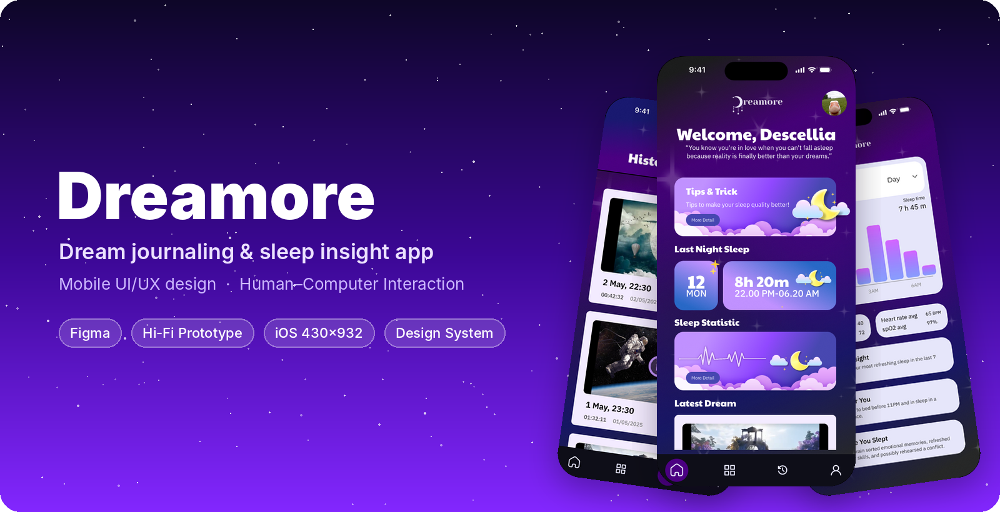

  

**[View the Figma file →](https://www.figma.com/design/XE4btMwzWLFnHD4XHppo9U/HCI-Dream-Catcher?node-id=0-1)**

---

## About

**Dreamore** is a mobile app concept that helps people **record their dreams, replay them, and understand their sleep**. It was designed as a Human–Computer Interaction (HCI) project at Universitas Multimedia Nusantara.

The app is built for people who want to understand their sleep patterns, improve sleep quality, and use dream tracking as a tool for self-awareness. Users can record a dream, watch it back as a visual story with an AI-generated meaning, and see their sleep score, sleep stages, and brainwave-based analysis in one place.

---

## Key Features

| | Feature | What it does |
|---|---|---|
| 🌙 | **Record Your Dream** | Start a recording session with one tap before sleeping |
| 🎬 | **Dream History & Playback** | Browse past dreams as video cards, replay them, and see the dream type, score, and meaning |
| 💤 | **Sleep Monitor** | Daily, weekly, and monthly sleep score, sleep stages (Awake, REM, Core, Deep), heart rate, and SpO₂ |
| 🧠 | **Dream Analysis** | Brainwave charts (Alpha, Beta, Theta, Delta, Gamma) with report export, sharing, and comparison |
| 💡 | **Tips & Insights** | Personalized sleep tips, weekly insights, and a "While You Slept" summary |
| 🔐 | **Account & Security** | Social sign-in, profile editing, password change, two-factor authentication, login alerts |

---

## Screens

### 01 · Onboarding
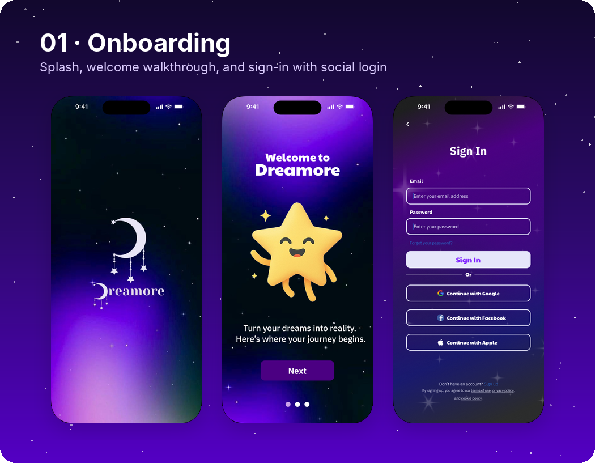

### 02 · Record & Relive Dreams
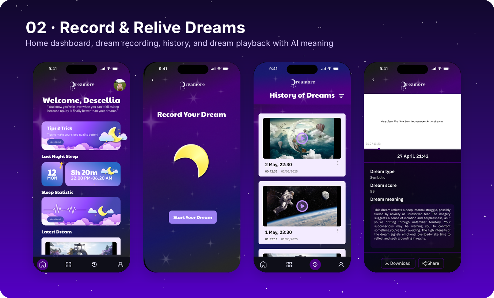

### 03 · Sleep Insights

  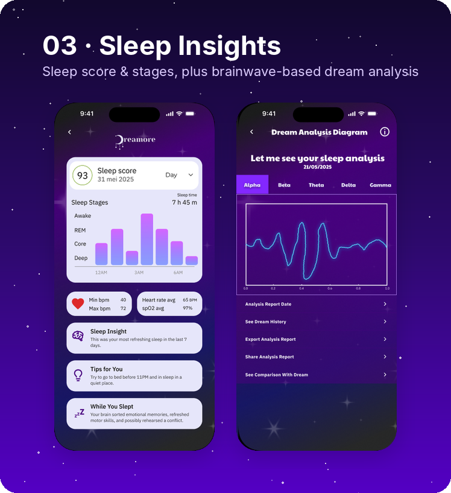

<b>View individual screens</b>

 

| Splash | Onboarding | Sign In |
|:---:|:---:|:---:|
| 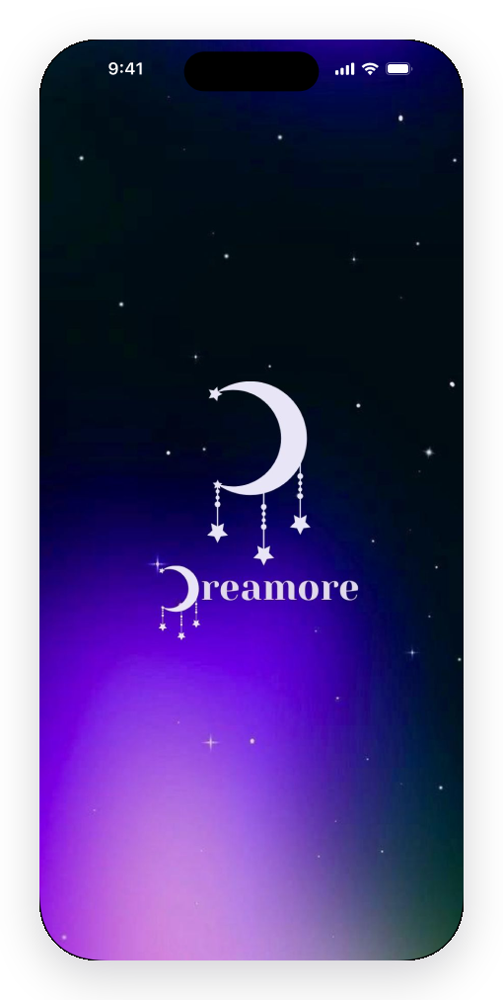 | 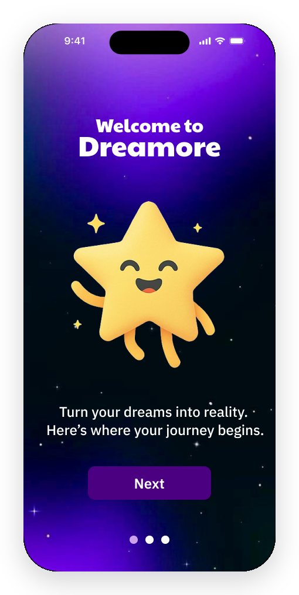 | 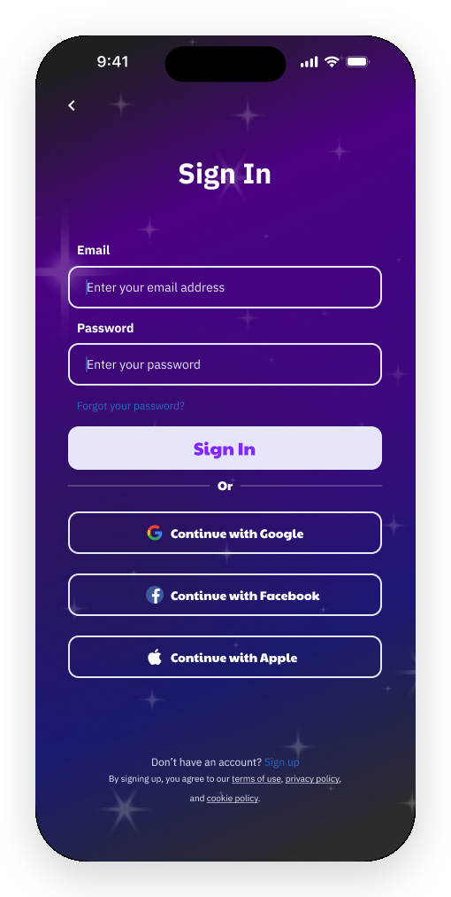 |
| **Home** | **Record Dream** | **Dream History** |
| 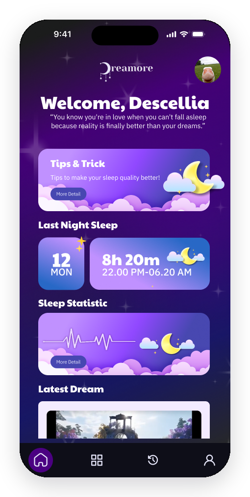 | 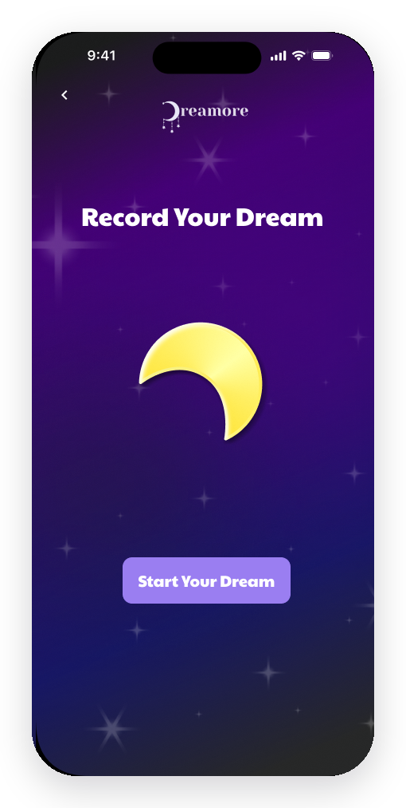 | 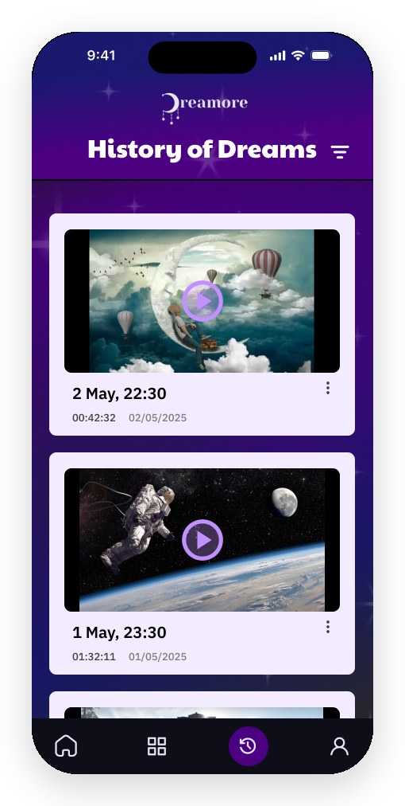 |
| **Watch Dream** | **Sleep Monitor** | **Dream Analysis** |
| 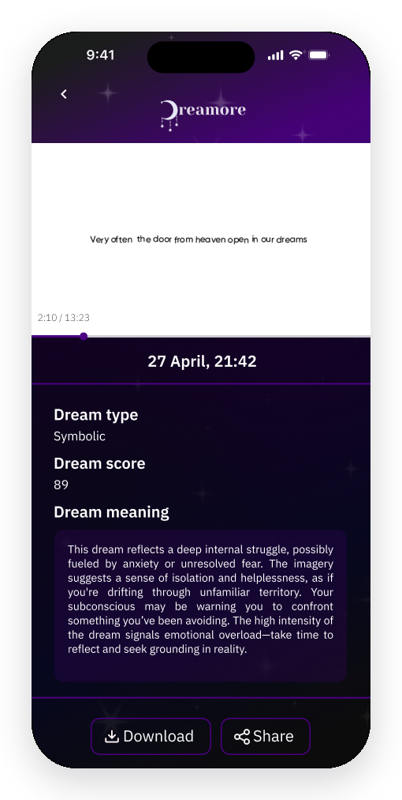 | 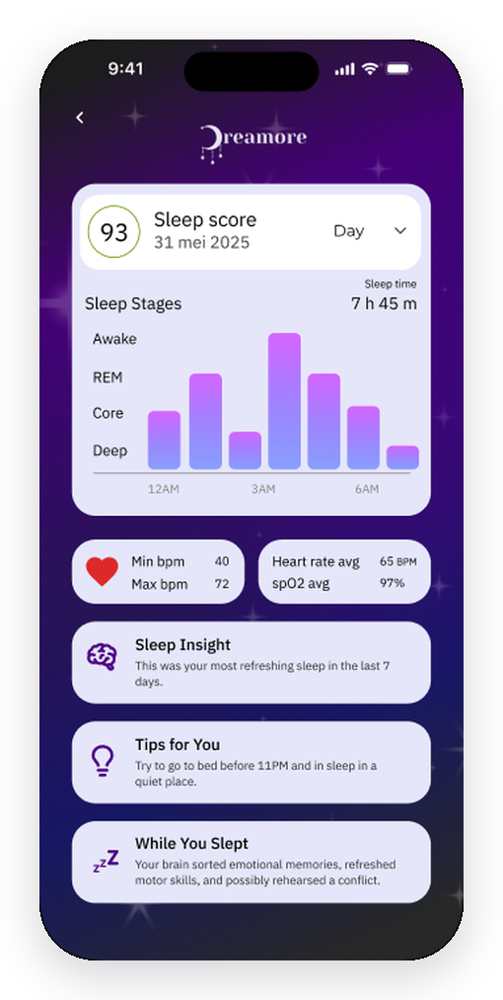 | 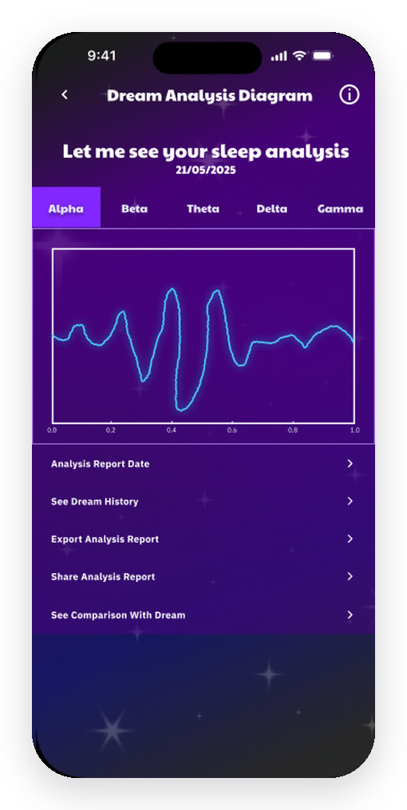 |

---

## Design System

**Color**

Deep-night purple gradients with soft lavender cards and warm moon-yellow accents.

**Typography**

| Role | Typeface | Usage |
|---|---|---|
| Display | **Paytone One** | Headlines, buttons, screen titles |
| Body | **IBM Plex Sans** | Body text, labels, data |

Type scale: H1 · H2 · H3 (Bold) · H4

**Tokens**

| Token | Values |
|---|---|
| Corner radius | Small 4 px · Medium 8 px · Large 12 px · Huge 24 px |
| Shadow | Extra Small · Small · Medium · Large (tinted `#8327FF`) |
| Grid | 6-column mobile grid on a 430 × 932 frame |
| Components | Primary, secondary, and alternate buttons; text fields; list boxes; modals; filters; bottom navigation |

---

## Design Process

The project followed a user-centered design process. Every stage is documented in the Figma file:

`Persona` → `Storyboard` → `Scenario` → `Design System` → `Component Set` → `Low-Fi Wireframe` → **`Hi-Fi Wireframe`**

This repository shows only the final **high-fidelity** screens.

---

## Tools

---

Designed by **Descellia Ng** · Informatics, Universitas Multimedia Nusantara

